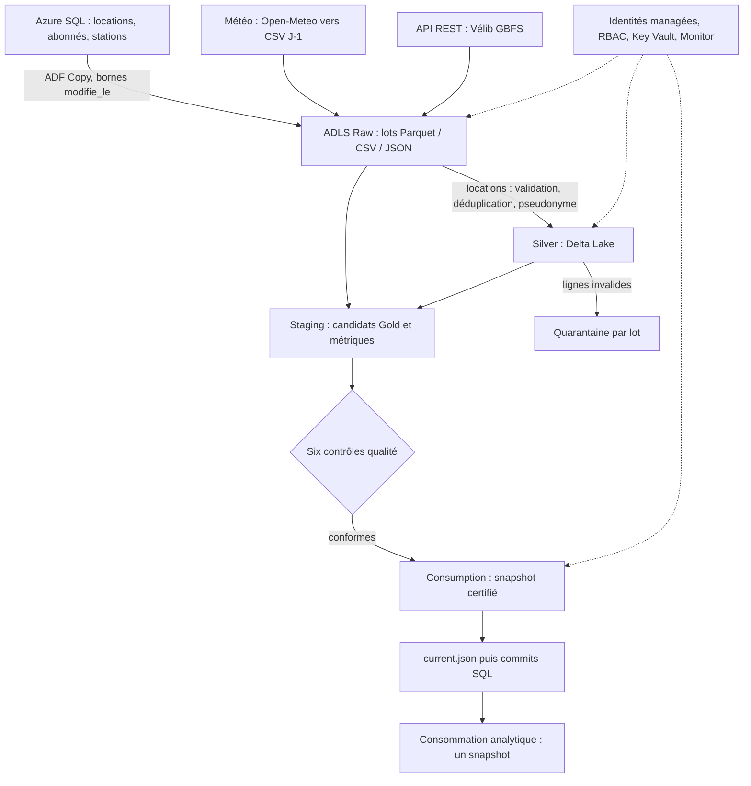

# VéloCité — Azure Lakehouse Architecture

Cas d’usage d’une chaîne Azure de données de mobilité : consolider les locations, produire des indicateurs quotidiens et rendre la publication contrôlable et reproductible. Ce dépôt contient l’export technique de la factory **adf-vct26a7b9**, pas des données d’abonnés.

## Architecture et objectifs

Les objectifs métier sont le suivi des locations, des montants et de la disponibilité. Les objectifs techniques sont la reprise incrémentale, l’idempotence, la qualité, la traçabilité et la protection des données.

Azure Data Factory orchestre les copies, Web Activities et Mapping Data Flows Spark ; ADLS Gen2 utilise le namespace hiérarchique. Azure SQL stocke les sources et watermarks. Key Vault protège le secret de pseudonymisation. Azure Monitor suit les échecs. Power BI est un consommateur cible : aucun PBIX ni rafraîchissement Desktop validé n’est livré. Le catalogue et le lineage sont documentaires, sans Purview déployé.

## Sources et couches

| Source | Traitement réel |
|---|---|
| SQL | 200 000 locations, 5 000 abonnés, 50 stations ; incrémental par date de modification, référentiel stations recopié |
| Météo CSV | Quatre villes : Paris, Lyon, Lille, Nantes ; Open-Meteo est converti en CSV pour J-1 |
| API REST | Une enveloppe JSON GBFS, contenant 1 519 stations observées ; référentiel distinct des 50 stations SQL |

Raw conserve les extractions par lot. Silver conserve la dernière version valide de chaque location en Delta, avec pseudonyme salé. Gold contient les agrégats journaliers et par station ainsi que la météo et les disponibilités ; les candidats sont construits dans Staging puis copiés dans un snapshot Consumption après contrôle. Les rejets restent en quarantaine.

## Orchestration et objets principaux

`PL_00_ORCHESTRATE_CERTIFIED_V2` capture les bornes, vérifie les permissions, appelle `PL_INGEST_SQL_V2`, exécute Silver seulement si le fichier existe, rafraîchit la météo (`PL_00_REFRESH_METEO_V2`) et REST (`PL_INGEST_API_V2`), puis `PL_03_CERTIFIED_ANALYTICS_V2`. Après certification : snapshot, pointeur, commits SQL et vérification des watermarks. La concurrence du maître est limitée à une exécution.

`PL_02_SQL_TO_SILVER_V2` appelle `DF_01_LOCATIONS_V2` avec un secret obtenu de Key Vault sans l’exposer. `DF_02_ANALYTICS_CERTIFIED_V2` construit les produits et mesures. `PL_RECOVER_CERTIFIED_COMMIT_V2` permet la reprise des commits après publication. Les anciennes variantes et pipelines `PL_TEST_*` sont conservés pour la traçabilité ; l’entrée de production est le maître certifié.

## Qualité et idempotence

Six dimensions : complétude, validité, unicité, cohérence, exactitude et fraîcheur. Les bornes, volumes et montants attendus sont rapprochés des résultats ; un échec bloque la publication. La fenêtre de reprise couvre sept jours de **modification**. Les lignes sont classées par clé/version ; seules les versions strictement plus récentes sont appliquées. Les tests isolés de huit entrées donnent quatre lignes uniques et trois rejets, sans nouveau commit Delta lors du rejeu. Voir [les tests](tests/RESULTATS.md) et [les preuves agrégées](docs/preuves/).

## Résultats validés

Run final **`c137cb82-4a6e-4412-adbf-a3ea52b751ea`**, **Succeeded**, le 23 octobre 2026, de 08:19:38 à 08:26:39 UTC, environ **7 min 1 s**. Il s’agit d’une validation sans nouvelles lignes SQL ; Silver est alors sauté. La certification conserve 200 000 locations uniques, 999 995,00 unités monétaires de source, 139 jours et 6 950 couples jour/station. Météo : quatre lignes ; API : 1 519 stations. Les six dimensions ne signalent aucun défaut dans les mesures conservées.

**Le SLA avant 06 h 30, heure de Paris, n’a pas été démontré.** Le marqueur final porte `execution_mode=validation` et `sla_met=false`. **Le déclencheur quotidien `TR_DAILY_PARIS_V2` reste désactivé (`Stopped`).** Le paramètre `validation_mode` est faux par défaut ; un succès d’essai hors horaire ne démontre pas le SLA quotidien.

## Sécurité et limites techniques

Identités managées et RBAC ciblé ; authentification SQL par identité système ; références Key Vault, jamais de sel, mot de passe, token ou clé dans ce dépôt. Les entrées/sorties sensibles des activités sont protégées. Les conteneurs sont privés, HTTPS et TLS 1.2 sont requis. Aucun fichier Raw, pseudonyme individuel, export d’abonnés ou historique contenant des secrets n’est publié. Les identifiants d’abonnement et de tenant sont neutralisés dans les preuves partagées.

Silver pseudonymisé reste une donnée personnelle. Les suppressions SQL physiques ne sont pas propagées. Le pointeur ADLS et les commits SQL ne constituent pas une transaction distribuée. Les écritures SQL concurrentes exigent des rapprochements bloquants ; les conflits à version identique, l’effacement des historiques et les endpoints privés ne sont pas validés. L’estimation du calculateur est **19,99 €/mois**, avec hypothèses explicites ; ce n’est pas une facture et le budget de suivi de 10 € n’est pas un plafond bloquant.

## Structure du dépôt

| Chemin | Contenu |
|---|---|
| `adf/pipelines/` | 18 pipelines JSON |
| `adf/dataflows/` | 6 Mapping Data Flows JSON |
| `adf/datasets/` | 12 datasets JSON |
| `adf/linkedservices/` | 3 connexions par identité managée / API publique |
| `adf/triggers/` | 1 déclencheur arrêté |
| `manifest.json` | Inventaire exact des 40 définitions |
| `sql/` | Requêtes de contrôle réellement extraites, périmètre SQL documenté |
| `docs/architecture/`, `docs/adr/` | Catalogue, lineage documentaire et cinq décisions complètes |
| `docs/runbook/`, `docs/couts/` | Reprise, rejeu, quarantaine, incident et devis |
| `docs/preuves/`, `tests/` | États agrégés Azure, résultats et vérification statique |

Les 40 définitions ont été comparées aux propriétés des objets publiés dans Azure le 23 octobre 2026 à 10:22 UTC : 40 correspondances, aucune différence ni définition manquante. Voir [le contrôle d’export](docs/preuves/export_live_comparison.json).

