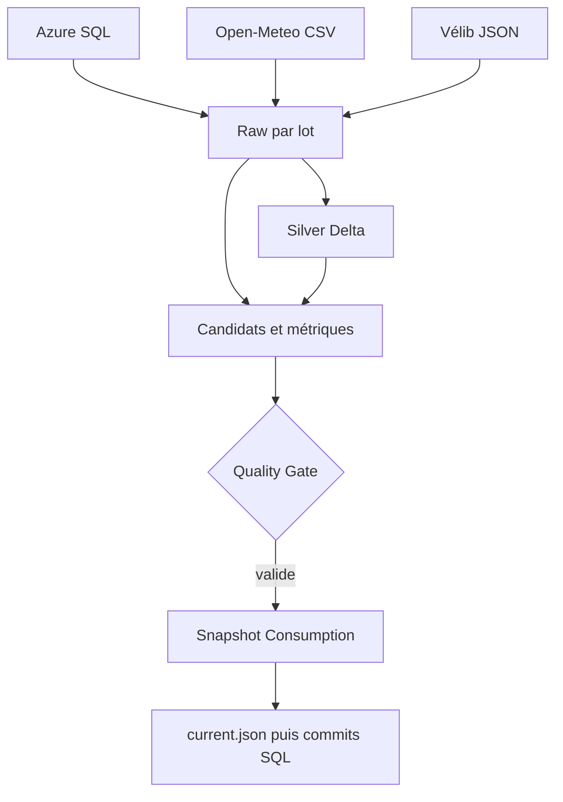

# Catalogue et lineage minimal

| Objet | Grain / clé | Transformation ou usage |
|---|---|---|
| SQL `abonnes` | `abonne_id` | Incrémental Raw, contrôles abonnés ; données directes restreintes |
| SQL `stations` | `station_id` | Référentiel de 50 stations de démonstration |
| SQL `locations` | `location_id`, `modifie_le` | Incrémental Raw, conversions et déduplication Silver |
| Raw météo CSV | ville, jour | Open-Meteo natif, J-1 Paris, Lyon, Lille et Nantes |
| Raw Vélib’ JSON | `data.stations[]` | Disponibilité réelle de 1 519 stations observées |
| `curated/locations_delta` | `location_id` | Delta, dernière version, pseudonyme salé |
| `staging/quarantine/locations/<lot>` | lot et ligne | Rejets, hors des produits de consommation |
| `staging/analytics/<lot>/quality` | une mesure par contrôle | Complétude, validité, unicité, cohérence, exactitude et fraîcheur |
| `consumption/snapshots/<lot>/daily` | jour de début Europe/Paris | Nombre, revenu, durée moyenne |
| `.../stations` | jour et station SQL | Nombre, revenu, durée moyenne |
| `.../meteo` | jour et ville | Température, pluie, vent |
| `.../velib` | station API | Disponibilités et métadonnées de fraîcheur |
| `.../disponibilite` | lot | Totaux et stations vides/pleines |
| `consumption/current.json` | dernier lot publié | Pointeur, bornes, mode et état du SLA |

SQL et API Vélib’ sont deux référentiels distincts : aucun rattachement artificiel entre les 50 stations de démonstration et les stations réelles. L'API fournit un état présent ; la météo est J-1. La fraîcheur du flux utilise `last_updated` ou `lastUpdatedOther`, distinct de `last_reported` d'une station inactive.

Le secret Key Vault reste à part et n'est pas un produit de données. Les projections Gold excluent les identifiants et pseudonymes d'abonnés. Le catalogue présent est documentaire : aucun lineage Purview exécuté n'est revendiqué.

Pour Power BI, lire le pointeur puis les Parquet d'un seul snapshot. Calculer la durée moyenne globale en pondérant les moyennes par `nb_locations`. Aucun PBIX ou rafraîchissement Power BI Desktop n'a été testé.
